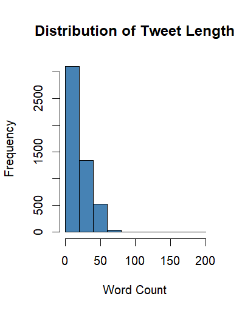
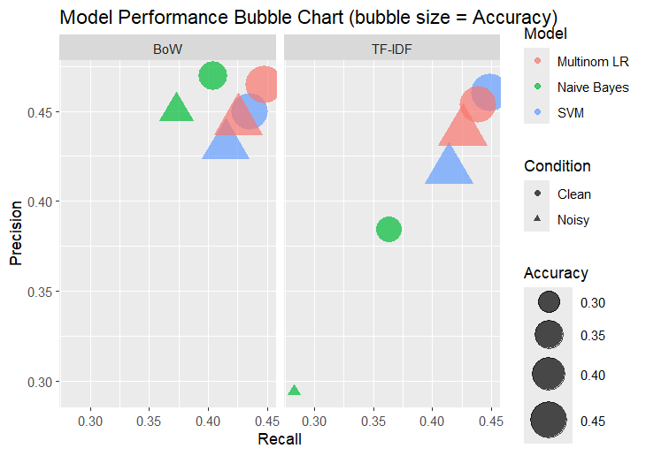
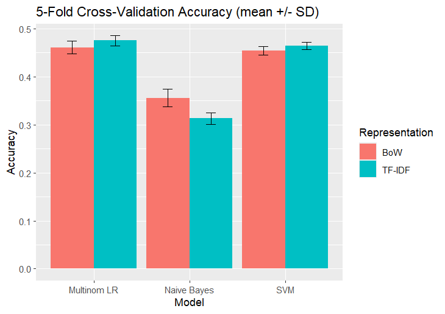

# Data Science - Twitter Sentiment Noise Robustness

A **Data Science / NLP** project for analyzing Twitter sentiment classification under synthetic text noise using different text representations and machine learning classifiers.

## Features

* Twitter Sentiment Analysis
* Text Preprocessing
* Bag of Words (BoW)
* TF-IDF
* Naive Bayes
* Linear SVM
* Multinomial Logistic Regression
* Word Deletion Noise
* Character Swap Noise
* Clean vs Noisy Data Analysis
* 5-Fold Cross-Validation
* Accuracy, Precision, Recall, F1 & Kappa
* Confusion Matrix
* Data Visualization

## Technologies

* R
* RStudio
* tidyverse
* tm
* caret
* SnowballC
* e1071
* nnet
* wordcloud
* RColorBrewer
* ggplot2

## Project Structure

```text
DataScience-Twitter-Sentiment-Noise-Robustness/
│
├── Code/
│   ├── Twitter_Sentiment_Noise_Robustness.R
│   └── Twitter_Sentiment_Noise_Robustness.Rproj
│
├── DataSet/
│   └── Twitter_Sentiment_Training_Dataset.csv
│
├── Documentation/
│   └── R_Analysis_Output_Report.docx
│
├── Outputs/
│   ├── Figures/
│   └── Tables/
│
├── Paper/
│   ├── Twitter_Sentiment_Noise_Robustness_Paper.pdf
│   └── Twitter_Sentiment_Noise_Robustness_Paper_Source.zip
│
├── .gitignore
└── README.md
```

## Project Screenshots

### Sentiment Distribution


### Tweet Length Distribution



### Tweet Length by Sentiment


### Word Cloud


### Clean vs Noisy Accuracy


### Accuracy vs Noise Level


### Model Performance



### 5-Fold Cross-Validation



## Dataset

The dataset contains:

* Tweet ID
* Entity
* Sentiment
* Tweet Text

Sentiment classes:

* Positive
* Negative
* Neutral
* Irrelevant

## How to Run

Install **R** and **RStudio**, then install the required packages:

```r
install.packages(c(
  "tidyverse",
  "tm",
  "caret",
  "SnowballC",
  "e1071",
  "nnet",
  "wordcloud",
  "RColorBrewer",
  "ggplot2"
))
```

Open:

```text
Code/Twitter_Sentiment_Noise_Robustness.Rproj
```

Then run:

```text
Code/Twitter_Sentiment_Noise_Robustness.R
```

## Research Paper

The research paper and source files are available in the `Paper/` folder.

## Author

**Najiat Islam Rishad**