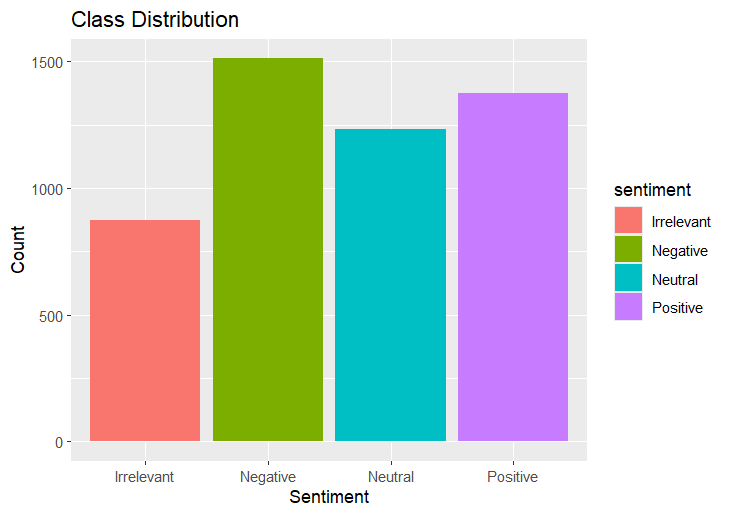
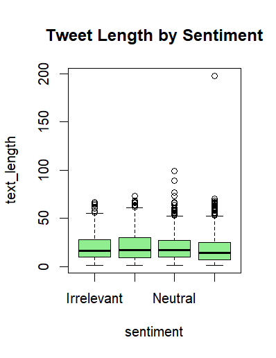
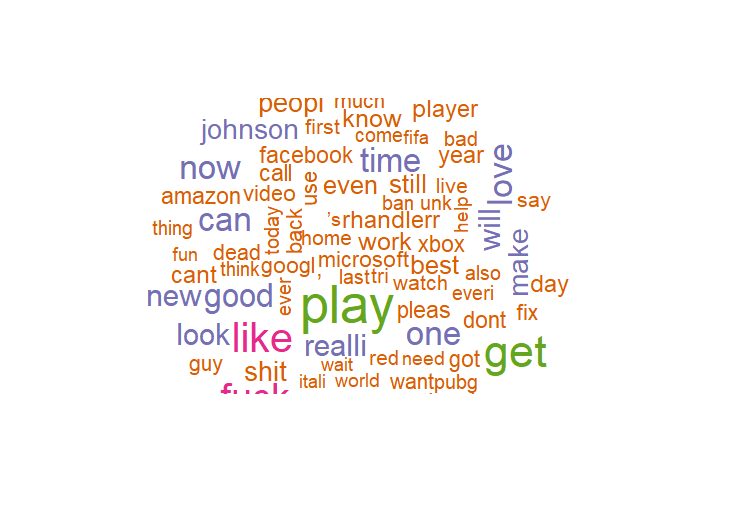
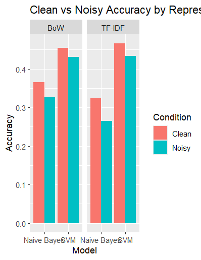
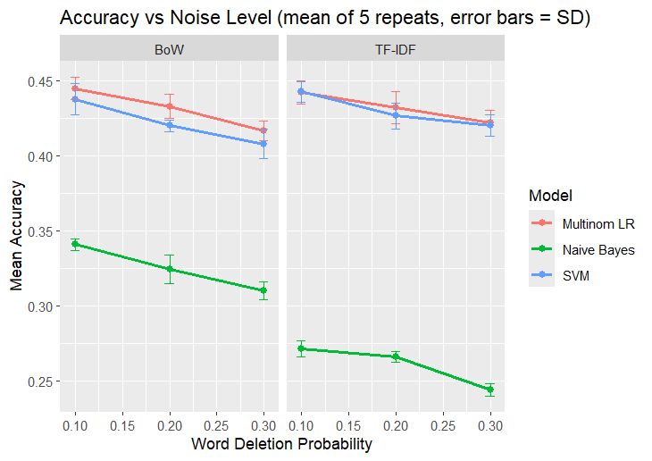
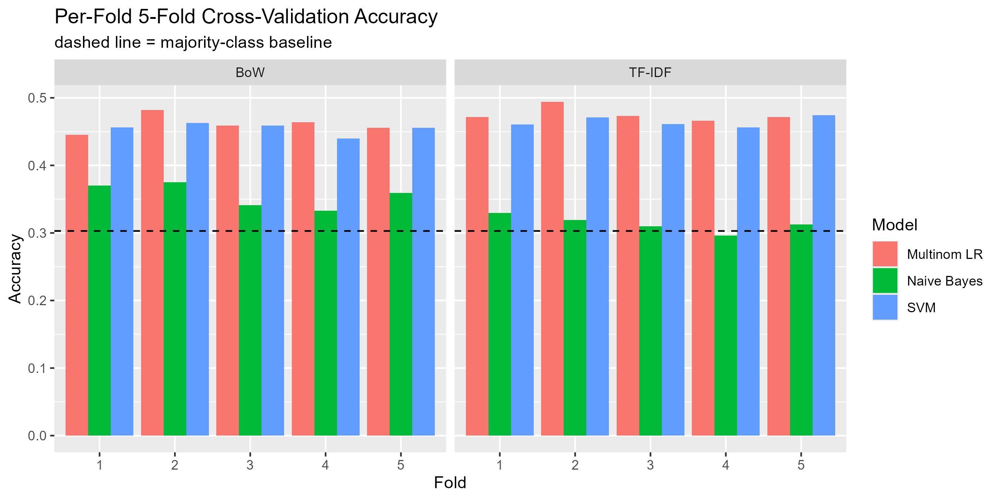
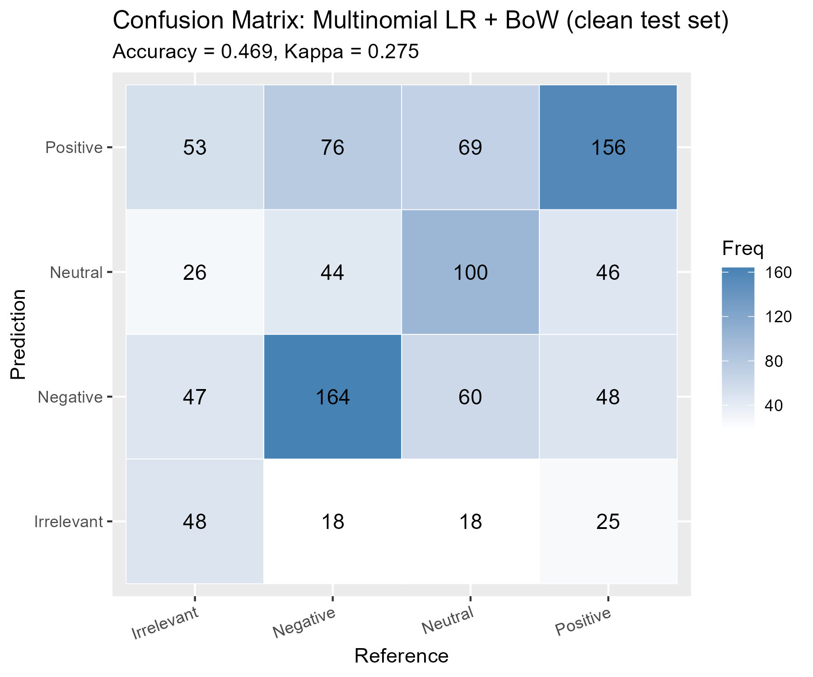

# Twitter Sentiment Noise Robustness

A Data Science / NLP project in **R** that tests how well Twitter sentiment classifiers keep working
when the tweet text has noise (deleted words and swapped characters).
Bag of Words and TF-IDF features are compared with Naive Bayes, Linear SVM and Multinomial Logistic Regression.

Introduction to Data Science project, AIUB. The results are written up as a research paper:
*Classifier Choice Outweighs Representation Choice for Noise-Robust Twitter Sentiment Classification*.

**Semester:** Summer 2025-2026

## Features

- Tweet cleaning and text preprocessing (lowercase, stop words, stemming).
- Stratified sample of 5,000 tweets in 4 classes: Positive, Negative, Neutral, Irrelevant.
- Bag of Words (BoW) and TF-IDF text representations.
- Naive Bayes, Linear SVM and Multinomial Logistic Regression classifiers.
- Synthetic noise: word deletion and character swap, tested at different noise levels.
- Clean vs noisy comparison with accuracy, precision, recall, F1 and Kappa.
- 5-fold cross-validation and confusion matrix.
- Charts, word cloud and result tables saved to `Outputs/`.

## Result in Short

The best model was **Multinomial Logistic Regression with BoW** (about 47% accuracy on clean data, 44% with noise; the majority-class baseline is 30%).
SVM and Logistic Regression lost only 1–3% accuracy with noise, while Naive Bayes dropped the most, so the choice of classifier mattered more than BoW vs TF-IDF.

## Technologies Used

- R and RStudio
- tidyverse, ggplot2
- tm, SnowballC (text mining)
- caret, e1071, nnet (machine learning)
- wordcloud, RColorBrewer

## Project Structure

```
DataScience-Twitter-Sentiment-Noise-Robustness/
├── Code/
│   ├── Twitter_Sentiment_Noise_Robustness.R      # full analysis, step by step
│   └── Twitter_Sentiment_Noise_Robustness.Rproj  # open this in RStudio
├── DataSet/
│   └── Twitter_Sentiment_Training_Dataset.csv
├── Outputs/
│   ├── Figures/                                  # all charts
│   └── Tables/                                   # metrics and confusion matrix (CSV)
├── Documentation/
│   └── R_Analysis_Output_Report.docx             # R output report
└── Paper/
    ├── Twitter_Sentiment_Noise_Robustness_Paper.pdf
    └── Twitter_Sentiment_Noise_Robustness_Paper_Source.zip   # LaTeX source of the paper
```

## Requirements

- **R** – download from [cran.r-project.org](https://cran.r-project.org/)
- **RStudio Desktop** – download from [posit.co](https://posit.co/download/rstudio-desktop/)

## Clone the Project

```bash
git clone https://github.com/munshi-rishad/DataScience-Twitter-Sentiment-Noise-Robustness.git
```

## Setup and Run

1. Install **R** and then **RStudio**.
2. Open RStudio and install the packages once (paste in the Console and press Enter):

   ```r
   install.packages(c("tidyverse", "tm", "caret", "SnowballC", "e1071",
                      "nnet", "wordcloud", "RColorBrewer", "ggplot2"))
   ```

3. Open `Code/Twitter_Sentiment_Noise_Robustness.Rproj` (double-click it). This sets the right working folder.
4. Open `Twitter_Sentiment_Noise_Robustness.R` from the Files panel and click **Source** (or press `Ctrl + Shift + S`).
5. The results are printed in the Console, charts appear in the Plots panel and the tables and figures are saved to `Outputs/`.

> Training the models and the cross-validation can take a few minutes.

## Dataset

Each row of `Twitter_Sentiment_Training_Dataset.csv` has a tweet ID, the entity (topic), the sentiment label and the tweet text.
The four sentiment classes are **Positive**, **Negative**, **Neutral** and **Irrelevant**.

## Research Paper

[Twitter_Sentiment_Noise_Robustness_Paper.pdf](Paper/Twitter_Sentiment_Noise_Robustness_Paper.pdf)

## Screenshots

### 1. Sentiment Distribution

Number of tweets in each sentiment class in the sample.

<p align="center">
  
</p>

### 2. Tweet Length by Sentiment

How long the tweets are in each class.

<p align="center">
  
</p>

### 3. Word Cloud

The most frequent words after preprocessing.

<p align="center">
  
</p>

### 4. Clean vs Noisy Accuracy

Accuracy of each model on clean text and on noisy text.

<p align="center">
  
</p>

### 5. Accuracy vs Noise Level

How accuracy goes down as more noise is added.

<p align="center">
  
</p>

### 6. 5-Fold Cross-Validation

Accuracy of every model in each of the 5 folds.

<p align="center">
  
</p>

### 7. Confusion Matrix

Predictions of the best model (Multinomial LR + BoW, clean data).

<p align="center">
  
</p>
